# 📸 AbsensiKCIC — Aplikasi Absensi Berbasis Foto, GPS & Waktu

> Aplikasi web mobile-first (PWA) untuk absensi karyawan dan anak magang KCIC.
> Setiap absen wajib berupa **foto selfie** yang otomatis diberi stempel **lokasi GPS** dan **waktu server** secara real-time.

---

## ✨ Fitur Utama

- 📷 **Absen via foto selfie** — langsung dari kamera (tidak bisa dari galeri)
- 🗺️ **Validasi GPS + Geofence** — hanya bisa absen dari zona yang diizinkan (kantor, stasiun KCIC, depo)
- 🕐 **Timestamp dari server** — tahan manipulasi jam HP
- 🔒 **Pengunci Absen Pulang** — tombol pulang terkunci sampai 9 jam kerja terpenuhi + hitung mundur
- 🔥 **Overlay burn-in** — tanggal, jam, koordinat, dan nama user menyatu di dalam file foto
- 📊 **Dashboard Admin** — pantau kehadiran real-time, lihat foto & peta, ekspor CSV/Excel
- 📲 **PWA** — bisa di-*Add to Home Screen*, load cepat

---

## 🛠️ Tech Stack

| Layer | Teknologi |
|---|---|
| **Frontend** | Next.js (React) |
| **Backend** | Laravel (PHP) |
| **Database** | PostgreSQL |
| **Photo Storage** | Local server (disk) |
| **CSS / UI** | Bootstrap |
| **Kamera & GPS** | `getUserMedia` + `navigator.geolocation` |
| **Overlay Foto** | HTML Canvas |
| **Hosting** | Vercel (frontend) + Render (backend) |

---

## 📁 Struktur Repository

```
absensi-kcic/
├── frontend/          # Next.js App
│   ├── app/
│   ├── components/
│   ├── public/
│   └── package.json
├── backend/           # Laravel App
│   ├── app/
│   │   ├── Http/Controllers/
│   │   ├── Models/
│   │   └── Services/
│   ├── routes/api.php
│   ├── database/migrations/
│   └── composer.json
└── README.md
```

---

## 🚀 Setup & Instalasi (Step by Step)

> [!IMPORTANT]
> Pastikan lo udah install semua prerequisites di bawah sebelum mulai.

### Prerequisites

Sebelum mulai, pastiin lo punya:

| Tools | Versi Minimum | Cek |
|---|---|---|
| Node.js | v18+ | `node -v` |
| npm / yarn | v9+ | `npm -v` |
| PHP | v8.2+ | `php -v` |
| Composer | v2+ | `composer -v` |
| PostgreSQL | v15+ | `psql --version` |
| Git | terbaru | `git --version` |

---

### 1️⃣ Clone Repository

```bash
git clone https://github.com/USERNAME/absensi-kcic.git
cd absensi-kcic
```

---

### 2️⃣ Setup Backend (Laravel)

#### a. Masuk ke folder backend

```bash
cd backend
```

#### b. Install dependencies PHP

```bash
composer install
```

#### c. Copy file environment

```bash
cp .env.example .env
```

#### d. Edit file `.env`

Buka file `backend/.env` dan isi bagian berikut:

```env
APP_NAME="AbsensiKCIC"
APP_ENV=local
APP_KEY=                       # akan di-generate otomatis
APP_DEBUG=true
APP_URL=http://localhost:8000

# Database PostgreSQL
DB_CONNECTION=pgsql
DB_HOST=127.0.0.1
DB_PORT=5432
DB_DATABASE=absensi_kcic
DB_USERNAME=postgres
DB_PASSWORD=YOUR_DB_PASSWORD

# Timezone (penting!)
APP_TIMEZONE=Asia/Jakarta

# Storage foto (local disk)
FILESYSTEM_DISK=local

# CORS (izinkan request dari frontend)
FRONTEND_URL=http://localhost:3000
```

#### e. Generate application key

```bash
php artisan key:generate
```

#### f. Buat database PostgreSQL

Jalankan di psql atau pgAdmin:

```sql
CREATE DATABASE absensi_kcic;
```

#### g. Jalankan migrasi database

```bash
php artisan migrate
```

#### h. (Opsional) Seed data awal

```bash
php artisan db:seed
```

> [!NOTE]
> Seeder akan membuat akun Admin default: `admin@kcic.id` / `password123`

#### i. Buat symlink storage

```bash
php artisan storage:link
```

#### j. Jalankan backend server

```bash
php artisan serve
# Backend berjalan di http://localhost:8000
```

---

### 3️⃣ Setup Frontend (Next.js)

#### a. Buka terminal baru, masuk ke folder frontend

```bash
cd frontend
```

#### b. Install dependencies Node.js

```bash
npm install
```

#### c. Copy file environment

```bash
cp .env.local.example .env.local
```

#### d. Edit file `.env.local`

```env
NEXT_PUBLIC_API_URL=http://localhost:8000/api
NEXT_PUBLIC_APP_NAME=AbsensiKCIC
```

#### e. Jalankan development server

```bash
npm run dev
# Frontend berjalan di http://localhost:3000
```

#### f. Buka di browser

```
http://localhost:3000
```

> [!IMPORTANT]
> Akses **wajib** via HTTPS di production karena fitur kamera (`getUserMedia`) dan GPS tidak berjalan di HTTP.
> Untuk development localhost, browser masih mengizinkan HTTP.

---

### 4️⃣ Verifikasi Setup Berhasil

Checklist setelah setup:

- [ ] Backend `http://localhost:8000/api/health` → response `{"status":"ok"}`
- [ ] Frontend `http://localhost:3000` → halaman login muncul
- [ ] Login dengan `admin@kcic.id` / `password123` berhasil
- [ ] Halaman dashboard admin terbuka
- [ ] Izin kamera dan GPS muncul saat mencoba absen

---

## 🌐 Deploy ke Production

### Frontend → Vercel

1. Push repo ke GitHub
2. Buka [vercel.com](https://vercel.com) → **New Project** → pilih repo ini
3. Set **Root Directory** ke `frontend`
4. Tambah environment variables:
   ```
   NEXT_PUBLIC_API_URL=https://your-backend.render.com/api
   ```
5. Deploy!

### Backend → Render

1. Buka [render.com](https://render.com) → **New Web Service**
2. Connect ke repo GitHub, set **Root Directory** ke `backend`
3. Pilih **PHP** sebagai runtime (atau gunakan Docker)
4. Set environment variables sesuai `.env` (gunakan PostgreSQL dari Render)
5. Deploy!

> [!WARNING]
> Di production, pastikan `APP_DEBUG=false` dan `APP_ENV=production` di backend `.env` supaya error tidak bocor ke user.

---

## 🗺️ Zona Absensi yang Diizinkan

Absen hanya bisa dilakukan dari salah satu zona berikut:

| Lokasi | Radius Default |
|---|---|
| Kantor KCIC | 100 m |
| Stasiun KCIC Halim (Jl. Halim Perdana Kusuma) | 300 m |
| Stasiun Karawang | 300 m |
| Stasiun Padalarang | 300 m |
| Stasiun Tegalluar | 300 m |
| Depo KCIC | 500 m |

> [!NOTE]
> Admin dapat mengubah titik koordinat dan radius tiap zona melalui dashboard.

---

## 👥 Role & Akses

| Role | Akses |
|---|---|
| **Karyawan / Magang** | Absen masuk & pulang, lihat riwayat absen sendiri |
| **Admin / HR** | Semua akses karyawan + dashboard, filter, approve koreksi, ekspor laporan |

---

## 📐 Aturan Bisnis Inti

1. **Durasi kerja wajib = 9 jam** (dapat diubah Admin)
2. **Tombol Absen Pulang terkunci** sampai `jam_masuk + 9 jam` menurut waktu server
3. **Timestamp selalu dari server** (zona waktu WIB / Asia/Jakarta)
4. **Satu hari = satu sesi** — absen ganda ditolak
5. **Foto wajib dari kamera langsung** — tidak bisa upload dari galeri
6. **Di luar zona → absen ditolak**, percobaan tetap dicatat di log untuk audit

---

## 🧪 Testing

```bash
# Backend (Laravel)
cd backend
php artisan test

# Frontend (Next.js)
cd frontend
npm run test
```

---

## 📋 API Endpoints (Ringkasan)

| Method | Endpoint | Deskripsi |
|---|---|---|
| `POST` | `/api/auth/login` | Login user |
| `POST` | `/api/auth/logout` | Logout |
| `GET` | `/api/attendance/today` | Status absen hari ini |
| `POST` | `/api/attendance/clock-in` | Absen masuk (foto + GPS) |
| `POST` | `/api/attendance/clock-out` | Absen pulang (foto + GPS) |
| `GET` | `/api/attendance/history` | Riwayat absen user |
| `GET` | `/api/admin/attendance` | Daftar absen semua user (Admin) |
| `GET` | `/api/admin/attendance/export` | Ekspor CSV/Excel (Admin) |

---

## 🗃️ Skema Database (Garis Besar)

```
users            → id, nama, email, password_hash, role, departemen, status
locations        → id, nama, latitude, longitude, radius_m, aktif
attendances      → id, user_id, tanggal, clock_in_at, clock_in_photo_url,
                   clock_in_lat, clock_in_lng, earliest_clock_out_at,
                   clock_out_at, clock_out_photo_url, total_work_minutes, status
corrections      → id, attendance_id, alasan, status, reviewer_id
settings         → required_work_duration_minutes, timezone, geofence_enabled
audit_logs       → id, actor_id, aksi, data_lama, data_baru, waktu
```

---

## 🗓️ Roadmap

```mermaid
flowchart LR
    A["🚀 MVP (Fase 1)"] --> B["📋 Fase 2"] --> C["🔬 Fase 3"]

    subgraph A["🚀 MVP (Fase 1)"]
        A1["Login & Role"]
        A2["Absen Foto + GPS"]
        A3["Pengunci 9 Jam"]
        A4["Dashboard Admin"]
        A5["Ekspor CSV"]
        A6["Geofence 1 Lokasi"]
    end

    subgraph B["📋 Fase 2"]
        B1["Koreksi & Approval"]
        B2["Izin / Cuti"]
        B3["Multi-Lokasi"]
        B4["Notifikasi Pengingat"]
        B5["Role Supervisor"]
    end

    subgraph C["🔬 Fase 3"]
        C1["Face Matching"]
        C2["Mode Offline Penuh"]
        C3["Integrasi Payroll"]
        C4["Aplikasi Native"]
    end
```



---

## 🤝 Kontribusi

Karena ini project solo, tapi kalau mau kontribusi:

1. Fork repo ini
2. Buat branch baru: `git checkout -b feature/nama-fitur`
3. Commit perubahan: `git commit -m "feat: tambah fitur X"`
4. Push: `git push origin feature/nama-fitur`
5. Buat Pull Request

---

## 📄 Lisensi

MIT License — bebas digunakan untuk keperluan internal KCIC.

---

<p align="center">Built with ❤️ for KCIC Internship & Employee Management</p>
